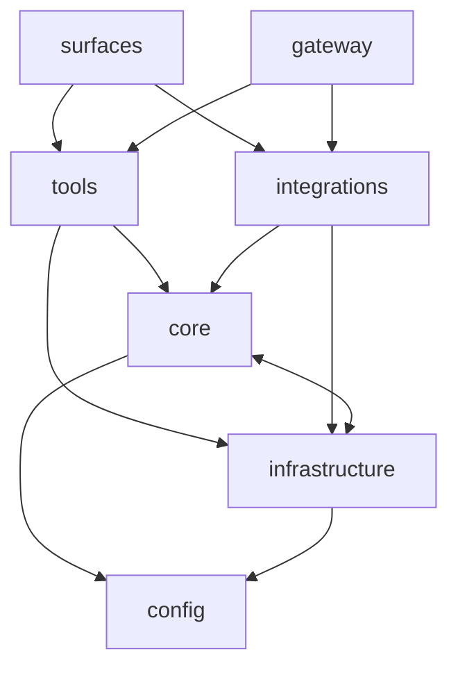

今天在 GitHub Trending 上看到一个有意思的项目：**OpenSRE**（`Tracer-Cloud/opensre`）。它要解决的是一个所有工程师都熟悉的场景——CI 变红了，流水线只告诉你「失败了」，却不会告诉你为什么失败、更不会替你修。OpenSRE 是一个可自托管的 CI/CD 可靠性 Agent，读取失败的运行记录、追到根因，然后把修复推到分支上等你评审。项目当前约 15,046 star、2,004 fork，主要语言 Python，采用 Apache-2.0 协议，最新 release 为 `v0.1.2026.11.24`，仍处于 public alpha 阶段。

本文从架构原理讲到安装使用，把这套「AI SRE」的工程实现完整过一遍。

## 一、项目概述

### 它到底在解决什么问题

现代团队的代码有相当比例是 AI 写的，但构建失败之后收拾残局的人还是工程师。CI 红了的默认反应是点一下 re-run，然后继续干别的：偶发失败越积越多，`main` 长时间保持红色，真正的调查被推给「哪个资深工程师有空」。OpenSRE 的判断是，这段调查工作本身高度模式化——读日志、提出假设、验证、改代码、推送——正好适合交给一个带工具调用能力的 Agent。

它的定位不是「又一个 CI 看板」，而是把排障动作闭环：

- **快速从红构建恢复**：运行一失败就开始调查，读日志、验证假设，把修复推给你评审
- **修根因而不是重跑**：明确区分「CI 自身导致」和「代码导致」的失败，避免用重跑掩盖真实问题
- **量化 CI 的成本**：失败率、因不可靠 CI 损失的开发者工时、默认分支保持红色的时长
- **让每个人拥有资深视角**：分析深度不依赖当天谁在线
- **不止 CI/CD**：同一套 Agent 也能接入 EKS、EC2、CloudWatch、Kubernetes、Grafana（Loki / Mimir / Tempo）、Alertmanager、Datadog、Slack、GitHub，调查生产事故
- **自托管、自带模型**：跑在你自己的基础设施上，用你自己的 LLM

### 项目定位与成熟度

元数据里几个数字值得注意：仓库创建于 2026 年 1 月 13 日，不到一年积累到 15,046 star，最近一次推送就在今天，release tag 是带日期的 `v0.1.2026.11.24`，说明发版节奏相当快。README 顶部明确标注 **Public Alpha**：核心工作流可用，但还不完全稳定，API 与集成会演进。这一点在选型时很关键——它适合先做「辅助排障」而不是「无人值守自动合并」。

许可证是 Apache-2.0，对商业环境友好。代码结构上 Python 占绝对主体（约 23 MB），另有少量 Shell、PowerShell、Makefile 和 Dockerfile，说明它是一个以 CLI 为核心、同时照顾多平台安装的工程。

### 与同类工具的差异

市面上多数 AI 代码助手面向「写新代码」，OpenSRE 面向「维护已有流水线」。两个设计选择把它和泛化的 AIOps 平台区分开：

第一，它把 CI 失败分成 CI-caused 与 code-caused 两类。基础设施抖动、缓存失效、runner 镜像问题导致的失败，和真正的代码缺陷，处理方式完全不同；不区分就会陷入「改代码修流水线」的荒诞循环。

第二，它默认把修复推到 PR 分支而不是直接改主干。README 里明确写了拒绝 fork PR、绝不直接推送到 `main` 这类受保护分支。这个约束把 Agent 的风险控制在「提交一个待评审的 commit」这个量级。

## 二、技术原理

### 四层架构：依赖只能向下

OpenSRE 的仓库结构被刻意约束成四个层级、七个一方包（first-party package），而且这些依赖规则由 CI 强制执行（`make check-imports`）：

| 层级 | 包 | 允许导入 | 禁止导入 |
| --- | --- | --- | --- |
| 1（顶层） | `surfaces`、`gateway` | `tools`、`integrations`、`core`、`infrastructure`、`config` | — |
| 2 | `tools` | `core`、`infrastructure`、`config` | `surfaces`、`gateway` |
| 2 | `integrations` | `core`、`infrastructure`、`config` | `tools`、`surfaces`、`gateway` |
| 3 | `core`、`infrastructure` | `config` | 以上所有 |
| 4（底层） | `config` | 无 | 以上所有 |



规则一句话概括：依赖箭头只能向下。唯一的例外是 `core ⟷ infrastructure` 这一对设计上互相依赖的兄弟——`core` 需要 `infrastructure` 提供 guardrails、masking、可观测性和日志压缩，`infrastructure` 又需要 `core` 的状态与会话类型。

这个约束不是洁癖。`surfaces` 和 `gateway` 是并列的顶层，彼此不能导入，意味着新增一个前端（比如某个聊天平台）不需要动下面任何一层；`tools` 与 `integrations` 是并列的能力层，彼此也不能导入，避免了「工具代码里塞满厂商 SDK」的腐化。

### 能力层的切分：工具与集成分开

`integrations/` 负责**用户配置与外部客户端**：每个厂商一个目录（`integrations/datadog`、`integrations/grafana`、`integrations/github`……），包含配置归一化、凭据解析、`client.py`、`verifier.py`，以及该厂商自己的工具。`tools/` 负责**厂商中立的、Agent 可调用的能力**：工具注册表、交互式 Shell 的工具框架、`tools/system/`，以及少量真正跨厂商的 `tools/cross_vendor/`。

取舍很清楚：只服务一个厂商的工具放在 `integrations/<vendor>/tools/`，紧挨着它用的客户端和凭据；只有域内确实没有厂商概念的能力才进 `tools/`。这样既避免了 `tools` 反向依赖 `integrations`，也让「接一个新数据源」变成在一个目录里完成的事。

### ReAct 循环与统一回合宿主

Agent 本体在 `core/agent.Agent`，跑的是经典的 think → call tools → observe 循环，并且受 `core/context_budget.py` 的上下文预算约束。工具通过 `core/tool` 的注册表契约暴露，进程启动时由各能力包自己注册：

- `integrations/harness_adapters.py`
- `tools/harness_adapters.py`
- `integrations/scheduled_delivery.py`
- `integrations/scheduled_agent_bootstrap.py`

两个宿主（`surfaces/shared/process_boot.py` 与 `gateway/core/process/boot.py`）各自持有一份 `CAPABILITY_REGISTRARS`，测试会校验两份完全一致，防止注册逻辑散落。

另一个值得抄的设计是 `infrastructure/turn_host` 里的 `TurnRunner`：交互式 Shell 和所有网关传输都通过同一个回合执行器跑 Agent，两条入口路径因此不会各自漂移。通道差异被压到「怎么收消息、怎么渲染结果」，而不是「怎么跑 Agent」。

### 一次排障的六步数据流

README 把运行时行为拆成六步，这也是理解 OpenSRE 的最短路径：

1. **Fetch**：拉取失败检查与 CI 日志、最近提交与部署、关联的日志/指标/链路
2. **Mask**：向外发 LLM 请求前，可选地掩码敏感标识符（可逆）
3. **Reason**：在工具调用循环里跨系统验证假设，把 CI 故障与代码故障分开
4. **Answer**：在会话中返回带证据链接的结论
5. **Fix**：把修复推到 PR 分支供评审，或给出下一步建议并按需执行修复动作
6. **Post**：把摘要发到 Slack、PagerDuty 或 Telegram，不用切窗口

关键在第三步和第五步之间：结论必须能指回具体日志行、具体 commit、具体部署，否则「AI 说是缓存问题」这种答案没有工程价值。

### 修复动作的安全边界

CI 修复是一个会写仓库的操作，OpenSRE 在文档里把边界写得很细：读 PR 元数据或分支上最新失败的 run；抓取失败 job 的压缩日志；为指定仓库创建隔离 checkout，或对显式选择的本地目录使用 linked worktree（不动你当前分支和未提交改动）；拒绝 fork PR；合并落后的 base 分支时冲突交给编码 Agent，lockfile 重新生成而不是手工合并。

执行修复的编码 Agent 有三种来源：已登录的 Pi、Claude Code、Codex、Cursor 等 CLI，或者内置 Agent。`CODING_AGENT=auto` 是默认值，按顺序挑第一个就绪的 CLI，都不可用则回落到 `opensre`。内置 Agent 只在修复用的 checkout 内读写和跑命令，环境带 `CI=true`，且不注入 OpenSRE 或模型供应商的密钥——它自己也从不 commit / push，提交动作由外层工具完成。

## 三、安装与快速开始

### 环境要求

- 一个终端，最好在一个 Git 仓库里（完整流程演示需要）
- macOS（arm64 / x86_64）、Linux（x86_64 / arm64，需 glibc 2.35+，即 Ubuntu 22.04 一类）、Windows x86_64
- 从源码开发另需：Python 3.12+、Git、uv、Make（CI 用 Python 3.13）

### 安装（官方脚本，无需 sudo）

macOS 或 Linux：

```bash
curl -fsSL https://install.opensre.com | bash -s -- -gh
```

Windows（PowerShell）：

```powershell
& ([scriptblock]::Create((irm https://install.opensre.com/install.ps1))) -gh
```

安装器会拉取 `main` 上的最新构建，不需要 sudo。如果装完提示 `opensre` 找不到，按安装器打印的 PATH 指引操作，或者直接开一个新终端。

然后启动：

```bash
opensre
```

首次启动会走登录流程并激活托管模型（hosted model），所以本地不必先准备 API key。你会看到欢迎界面和登录提示。

### 源码安装（贡献者 / Python API 用户）

注意：独立 CLI 安装包**不提供可导入的 Python 包**，要用 Python API 必须从源码 checkout：

```bash
git clone https://github.com/Tracer-Cloud/opensre.git
cd opensre && make install
```

`make install` 等价于：

```bash
uv sync --frozen --extra dev
uv run python -m infrastructure.analytics.install
```

在此 checkout 里运行用 `uv run`：

```bash
uv run opensre ask "why is checkout-api slow?"
```

### 最小验证

交互式：

```bash
opensre
```

Headless 单轮：

```bash
opensre ask "why is checkout-api slow?"
```

如果模型和集成都没配好，`opensre ask` 会在 Agent 启动前以状态码 `1` 退出，并打印修复该问题的命令（例如 `opensre login <provider>`）。看到这条提示不是 bug，是它在替你定位配置缺口。

## 四、使用方法与实战

### 交互式 Shell：日常主入口

不带子命令运行 `opensre` 会校验账号并进入 REPL（需要 TTY）。用自然语言描述事故，Agent 边调工具边回答，斜杠命令负责会话控制：

| 命令 | 用途 |
| --- | --- |
| `/help` | 命令总览 |
| `/status` | 当前会话与配置状态 |
| `/cost` | 本轮 Token / 费用 |
| `/sessions`、`/resume` | 列出与恢复会话 |
| `/compact` | 压缩上下文 |
| `/new` | 开新会话 |
| `/exit` | 退出 |
| `/integrations list`、`/integrations verify` | 查看与验证集成 |

`Ctrl+C` 会取消进行中的回合但保留会话状态，这一点在 Agent 跑偏时很实用。

### Headless CLI：进脚本、进 CI

`opensre ask` 跑一个回合、打印结果、退出，每次运行默认保存为可恢复会话（`--ephemeral` 则不写历史、不打印 session id）：

```bash
opensre ask "why did checkout latency increase today?"
```

终端模式下完成时会打印会话 ID 和续跑命令：

```text
Session: 489e2ba8-3b7f-4fa2-bcdf-55a93177337c
Continue: opensre ask --resume 489e2ba8-3b7f-4fa2-bcdf-55a93177337c "<reply>"
```

支持前缀匹配：

```bash
opensre ask --resume 489e2ba8 "now check the last deployment"
```

需要机器可读结果时，把全局 `--json` 放在 `ask` **之前**：

```bash
opensre --json ask "summarize current service health"
```

输出是单个 JSON 对象，含 `status`、`response`、`session_id`、`questions`、`denied_tools`、`error`。退出码语义明确：

| 退出码 | 含义 |
| --- | --- |
| 0 | 完成 |
| 1 | 配置或执行失败 |
| 2 | 参数非法 |
| 3 | 有工具需要授权但被拒绝 |
| 4 | 需要结构化输入，用返回的 session 续跑 |
| 130 | 被 SIGINT 中断 |
| 143 | 被 SIGTERM 终止 |

把本地告警文件带进上下文用 `-i`，可重复，最多 16 个文件，单文件 64 KiB、合计 128 KiB：

```bash
opensre ask \
  -i alert.json \
  -i deployment.md \
  "correlate the alert with the recent deployment"
```

也可以直接从标准输入读 prompt：

```bash
cat incident-notes.txt | opensre ask -
```

### 工具授权：最小权限

只读工具自动放行；会改状态、访问外部服务、显式要求批准或未声明副作用的工具默认拒绝。授权按次生效，一个 `--allowed-tool` 只覆盖一个工具：

```bash
opensre ask "inspect the repository and run its focused tests" \
  --allowed-tool shell_run \
  --allowed-tool github_cli
```

根命令的 `-y` / `--yes` **不会**授权 Agent 工具，不要混淆。`--dangerously-bypass-approvals` 会放行所有受控工具，只应在提示词和集成都可信的隔离环境里用，且不能与 `--allowed-tool` 同时使用。

### 场景演练：从发现红 PR 到修复

假设要处理 `Tracer-Cloud/opensre` 这个仓库，在交互式 Shell 里依次输入：

```text
analyze Tracer-Cloud/opensre CI/CD performance for the last 30 days
how many PRs and branches currently have failing CI across all my orgs?
fix failing checks on Tracer-Cloud/opensre#4597
set up an agent that improves CI/CD reliability for Tracer-Cloud/opensre
```

第一步生成 30 天报告：失败率、CI-caused 与 code-caused 的占比、损失的开发者工时、默认分支的红灯时长。第二步做只读健康扫描，横跨 token 可见的所有仓库，列出哪些 PR 和分支在挂、挂在哪个 check 上。

第三步开始写操作。文档给出的执行顺序是：读 PR 元数据 → 抓失败 job 日志 → 建隔离 checkout（或校验本地 checkout 并开 linked worktree）→ 若 PR 分支落后 base 先合并 base → 应用修复 → commit → push 到 PR 头分支或新的 repair 分支 → 等待新 checks。

第四步配置的是周期性的可靠性 Agent：每个工作日早上读最近 7 天，把报告投到 Shell 收件箱；对应的修复循环对单个 PR 最多在十分钟内推三次修复。能力与写入范围在文档里有明确表格：分析只读、健康扫描不写、修 PR 会写一个 commit、可靠性 Agent 只产出报告。

同样的动作可以放进流水线。只读任务直接跑，需要审批的任务显式授权单个工具：

```bash
# 分析 / 扫描：无需授权
opensre --json ask "how many PRs currently have failing CI in Tracer-Cloud?"

# 修 PR：授权 fix_github_pr_ci
opensre ask --allowed-tool fix_github_pr_ci "fix failing checks on Tracer-Cloud/opensre#4597"

# 配置可靠性 Agent
opensre ask --allowed-tool schedule_ci_reliability_loop "set up an agent that improves CI/CD reliability for Tracer-Cloud/opensre"

# 为单个 PR 配置有界修复循环
opensre ask --allowed-tool schedule_ci_repair_loop "schedule a CI repair loop for Tracer-Cloud/opensre pull request 6054"
```

任务需要两个工具就写两次 `--allowed-tool`。未登录的机器需要 `LLM_PROVIDER` 加对应 key，再加一个 GitHub token。

### Python API：把 Agent 嵌进服务

源码 checkout 环境下，先注册适配器再开会话：

```python
from infrastructure.process.boot import EMBEDDED_PROFILE
from surfaces.shared.process_boot import configure_process

configure_process(EMBEDDED_PROFILE)
```

然后可以走 `AgentSession`：

```python
from core.agent_harness import AgentSession
from infrastructure.process.boot import EMBEDDED_PROFILE
from surfaces.shared.process_boot import configure_process

configure_process(EMBEDDED_PROFILE)
session = AgentSession.start()

result = session.chat("what's our GitHub star velocity over the last 7 days?")
action = result.action_result
if (
    result.cancelled
    or action.hit_iteration_cap
    or action.accounting_status != "completed"
    or not result.primary_response_text
):
    raise RuntimeError("Turn failed")

print(result.primary_response_text)
```

`core` 不允许反向导入宿主，所以 `AgentSession.start()` 不会替你注册适配器；想省掉这一步可以用 `surfaces.embedded.start_embedded_session()`，它内部走同一套 boot 流程。判断成功不要只看 `answered`——模型调用失败时也可能有文本，要同时看 `accounting_status == "completed"`、`cancelled` 和 `hit_iteration_cap`。

### 部署形态

按团队规模有三条路：

- **OpenSRE Cloud 托管网关**：组织管理员在 Web 应用里开通，登录的 Shell 用户可以直接查看、启停，不必在本地持有基础设施凭据
- **网关（AMI + systemd）**：`make build-gateway-image` 然后 `make deploy-gateway`，只支持 Telegram 网关、不用 Docker，把网关装进新服务器启动的镜像里
- **自托管容器（Railway / ECS / Vercel）**：部署仓库自带 `Dockerfile`，选 `MODE`（`web`、`gateway`、`scheduler`），设置 `LLM_PROVIDER` 及其 API key；只有网关需要共享 Postgres 状态（例如 Slack Events API 多副本）时才配 `DATABASE_URL`

### 集成面

README 声称覆盖 60+ 工具，按类别看：模型侧有 Anthropic、OpenAI、Ollama、Gemini、OpenRouter、Bedrock 等；可观测性有 Grafana 全家桶（Loki / Mimir / Tempo / annotations）、Datadog、CloudWatch、Sentry、Elasticsearch、Splunk、New Relic 等；基础设施有 Kubernetes、AWS（S3 / Lambda / EKS / EC2 / CloudTrail）、Azure、ArgoCD、Helm；数据库覆盖 MongoDB、ClickHouse、PostgreSQL、MySQL、Redis、Snowflake 等；另有 Airflow、Kafka、Prefect、Temporal 这类数据平台，以及 PagerDuty、Jira、ServiceNow 等事故管理工具。接完跑一次 `opensre integrations verify` 比读文档更靠谱。

## 五、常见问题与解决方案

**现象**：安装脚本跑完，`opensre` 提示 command not found。
**原因**：安装目录不在当前 shell 的 `PATH` 里，或当前终端还持有旧的环境变量。
**解决**：按安装器打印的 PATH 指引写进 shell 配置，然后开一个新终端再试；不要在同一条命令里 `source` 完就假定生效。

**现象**：Linux 上安装或启动直接失败。
**原因**：官方要求 glibc 2.35+（Ubuntu 22.04 一类），Alpine / musl 不受支持。
**解决**：换到受支持的发行版或 glibc 基础镜像；容器里部署时不要选 alpine tag。

**现象**：`opensre ask` 退出码 1，提示没有模型。
**原因**：既没登录托管模型，也没设置 `LLM_PROVIDER` 和对应 key。
**解决**：交互式登录，或按提示执行 `opensre login <provider>`；在 CI 里则显式注入 `LLM_PROVIDER` 与供应商 API key。注意独立安装包不含可导入的 Python 包，Python API 必须用源码 checkout。

**现象**：Headless 运行退出码 3，日志说工具被拒绝。
**原因**：会写状态的工具默认拒绝，`-y` 不授权 Agent 工具。
**解决**：按需加 `--allowed-tool`，一个工具一个参数，任务需要两个就写两次；不要在共享环境里图省事用 `--dangerously-bypass-approvals`。

**现象**：让它修某个 PR，被明确拒绝。
**原因**：该 PR 来自 fork。OpenSRE 只推同仓库分支。
**解决**：在目标仓库内开分支重提 PR，或在同仓库分支上让 Agent 修复；不要试图绕过这个限制。

**现象**：退出码 4，输出里有编号选项。
**原因**：Agent 缺少必要决策，进入 `needs_input`。
**解决**：拿 `session_id` 续跑，回答编号或按标签传 JSON：

```bash
opensre ask --resume 489e2ba8 '{"Repository":"1","Window":"2"}'
```

`--json` 模式下问题在 `questions` 数组里，含标题、选项、是否多选、是否允许自定义答案；JSON 模式不打印终端续跑提示，只能靠返回的 ID。

**现象**：Python 里 `AgentSession` 拿不到任何工具。
**原因**：跳过了 `configure_process(EMBEDDED_PROFILE)`。`core` 不能导入宿主，注册必须由调用方完成。
**解决**：先 `configure_process`，或直接用 `start_embedded_session()`。

**现象**：想让 Agent 直接把修复推到 `main`，但被挡。
**原因**：设计上从不直接推受保护分支；`fix the CI on main and push straight to main` 这类显式指令才会推到分支本身，而受保护分支仍会被拒。
**解决**：走 PR 分支或 repair 分支，把合并权留在人手里。

**现象**：担心日志里的敏感信息外泄。
**原因**：上下文会发给配置的 LLM 供应商。
**解决**：用内置的可逆 mask 能力处理标识符；`-i` 附带的文件也要先自查密钥。遥测可用 `export OPENSRE_NO_TELEMETRY=1` 关闭，prompt 日志另有 `OPENSRE_PROMPT_LOG_DISABLED=1`。

**现象**：升级后行为变了、参数不认了。
**原因**：项目处于 public alpha，API 与集成会演进。
**解决**：锁定版本、读 release notes；升级用 `opensre update`，彻底清理用 `opensre uninstall`（会删掉本地数据，执行前确认）。

## 六、总结

OpenSRE 的价值不在于「让 AI 写代码」，而在于把 CI 排障这段最容易被拖延的工作变成有证据链的自动流程：拉日志、分责任、给结论、推修复、留给人评审。四层架构、工具与集成的边界、统一的回合宿主，这些工程约束说明作者不是在做一个 demo，而是在为一个会长大的 Agent 系统打地基。

它适合这样的团队：CI 失败频繁、有多个仓库或多个云账号、愿意自托管并接受「Agent 提交、人来合并」的协作方式，尤其是已经在用 Grafana / Datadog / Kubernetes 这套可观测栈的 SRE 团队。不太适合两类场景：期待开箱即用全自动合并的团队，以及连基本 CI 历史都不完整的项目——没有可靠的运行数据，再好的推理也只能靠猜。

需要留意的局限也很明确：public alpha、API 会变、修复质量最终取决于所选模型和编码 Agent 的能力。比较稳妥的落地方式是先从只读的 30 天可靠性报告和健康扫描开始，让团队建立对结论的信任，再逐步放开 PR 修复与定时循环。

项目地址：<https://github.com/Tracer-Cloud/opensre>
