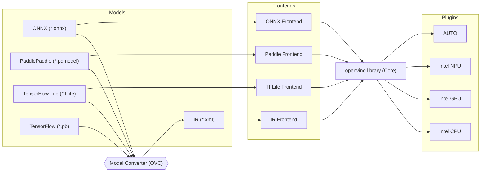

今天在 GitHub Trending 上看到一个有意思的项目：**OpenVINO™**（`openvinotoolkit/openvino`）。它解决的是模型训练完之后"怎么在真实硬件上跑得快、跑得省"这件事——把 PyTorch、TensorFlow、ONNX 等框架产出的模型，转换、压缩并编译到 Intel 的 CPU、GPU 和 NPU 上执行。项目用 C++ 编写，Apache-2.0 许可，目前约 12,350 star、3,683 fork，最新发布版本为 2026.4.1，仓库在 2026 年 11 月仍有持续提交。本文从架构原理到安装使用，带你完整过一遍。

## 一、项目概述

OpenVINO 全称 Open Visual Inference and Neural Network Optimization，最初由 Intel 在 2018 年开源，定位非常明确：**不是训练框架，而是推理侧的优化与部署工具包**。它要解决的问题是模型落地时的"最后一公里"——研究代码里跑得通的网络，换到没有 CUDA 的笔记本、工控机、边缘盒子或者带 NPU 的轻薄本上，往往既跑不快，也装不上。

从 README 看，它的核心能力可以归纳为几条：

- **推理优化**：面向计算机视觉、自动语音识别、生成式 AI、自然语言处理（含大语言模型与小语言模型）等常见任务提升深度学习性能。
- **灵活的模型来源**：支持 PyTorch、TensorFlow、ONNX、Keras、PaddlePaddle、JAX/Flax 训练的模型；通过 Optimum Intel 可直接对接 Hugging Face Hub 上的 transformers 与 diffusers 模型，转换后不再依赖原训练框架。
- **广泛的平台兼容**：可运行在 x86 与 ARM 架构的 CPU、Intel 集成显卡与独立显卡（GPU），以及 Intel NPU 等 AI 加速器上，覆盖从边缘到云的部署场景。
- **多语言 API**：提供 C++、Python、C、Node.js 接口，另有面向生成式 AI 流水线的 GenAI API。
- **生成式 AI 支持**：配套 `openvino.genai` 仓库与 OpenVINO Tokenizers，提供 LLM、文生图、语音识别、语音合成等开箱流水线。
- **完整生态**：NNCF 负责量化与稀疏化等压缩优化，OVMS（OpenVINO Model Server）负责可扩展的模型服务，此外还有 Geti 等标注工具。

成熟度方面，这个项目已经不算"新项目"：2018 年创建，至今近八年迭代，star 过万、fork 近三千七，许可证是宽松的 Apache-2.0，且默认分支 `master` 每天都有合并。它更适合被看作一套长期维护的基础设施，而不是尝鲜型工具。

与同类推理运行时相比，OpenVINO 的差异点在于**工具链的完整性**和**对 Intel 硬件的贴合度**。ONNX Runtime 更强调"一个运行时跑遍所有后端"，OpenVINO 则在自家硬件上把模型转换（OVC）、图优化、低精度变换、设备插件、服务化串成了一条线；代价是它的最佳体验集中在 Intel 平台上。

## 二、技术原理

### 整体分层

官方开发者文档给出了一张清晰的架构图，可以简化成这样：



这条链路里有四个关键角色：**Frontend（前端）**负责把不同格式的模型读进内存，统一成 OpenVINO 自己的图表示；**Model Converter（OVC）**负责把非 IR 格式离线转换成 IR；**Core 与 transformations**负责图的合法化与优化；**Plugins（插件）**负责把优化后的图编译到具体设备上执行。

### 机制一：IR 作为中间表示

IR（Intermediate Representation）是 OpenVINO 的核心资产，由 `.xml`（网络结构）和 `.bin`（权重）两个文件组成。所有前端最终都把模型翻译成同一套算子图，之后的优化、量化、设备编译都只面对这一种表示。

这样做的好处是解耦：新增一个框架前端，只需要实现"框架算子 → OpenVINO 算子"的映射，后面的优化与后端完全复用。代价是转换环节可能丢失原框架的动态语义，遇到自定义算子时需要额外的扩展或回退到原框架执行。

### 机制二：图变换与低精度变换

仓库里有两个容易被忽略但很关键的目录：`src/common/transformations` 和 `src/common/low_precision_transformations`。前者是通用图变换集合，负责常量折叠、算子融合、冗余节点消除、布局调整这类"让图更适合目标设备"的工作；后者专门处理低精度模型的模式识别与转换，例如把"反量化 → 卷积 → 量化"这种结构折叠成设备能直接吃的高效形式。

这也是 OpenVINO 性能优势的主要来源之一：**优化发生在编译期，而不是每次推理时**。模型只编译一次，之后每次 `infer` 都走已经裁剪好的执行图。

### 机制三：插件化的设备后端

`src/plugins` 下是各设备插件。对上，它们实现统一的 `ov::Core` 接口；对下，它们各自把图翻译成 CPU 指令、GPU kernel 或 NPU 的指令流。README 中明确支持的设备包括 x86/ARM CPU、Intel 集成与独立 GPU、Intel NPU。

```python
core = ov.Core()
print(core.available_devices)          # 查看当前机器可用设备
compiled = core.compile_model(model, "CPU")
```

`AUTO` 是一个特殊的"元插件"：它不直接执行计算，而是在可用设备之间做选择与回退。对部署方来说，这意味着同一份代码写上 `"AUTO"`，在高配机器上走 GPU、在没有独显的机器上退回 CPU，不必为每类硬件维护一套分支。

### 机制四：编译模型与推理请求

OpenVINO 的运行时分两步：`compile_model` 把 `ov::Model` 编译成 `CompiledModel`，这一步会做设备相关的图优化、内存规划和 kernel 选择；`CompiledModel` 再创建 `InferRequest`，负责真正的输入输出与执行。README 里的示例就是最直白的体现：

```python
compiled_model = core.compile_model(ov_model, 'CPU')
output = compiled_model({0: example.numpy()})
```

这种"编译期重、运行期轻"的取舍，非常适合推理服务：启动时多花几百毫秒到数秒，换来的是稳定的单次延迟。反过来说，如果模型形状频繁变化、每次请求都要重新编译，收益就会被抵消——这也是后面"常见问题"里会提到的坑。

## 三、安装与快速开始

### 环境要求

OpenVINO 提供 PyPI、Anaconda、Homebrew、NPM 以及各平台归档包等多种分发方式。最省事的是 pip 安装，Python 侧只需要一个可用的 Python 3 环境；系统与硬件支持范围可查官方 system requirements 与 supported devices 页面。

### 安装

README 给出的快速安装命令是：

```bash
pip install -U openvino
```

如果需要生成式 AI 流水线（LLM、文生图、语音），官方文档要求安装 GenAI 包而不是基础包：

```bash
python -m pip install openvino-genai
```

注意这两个包不是替代关系里的"新版旧版"：GenAI 包构建在 Runtime 之上，提供 `openvino_genai` 命名空间下的高层流水线。

### 验证安装

```python
import openvino as ov
print(ov.__version__)
```

能打印出版本号（当前发布线为 2026.4.1）就说明 Runtime 装好了。

### 最小可运行示例

README 里给了一个完整的 PyTorch 模型转换与推理例子，可以直接复制运行：

```python
import openvino as ov
import torch
import torchvision

# load PyTorch model into memory
model = torch.hub.load("pytorch/vision", "shufflenet_v2_x1_0", weights="DEFAULT")

# convert the model into OpenVINO model
example = torch.randn(1, 3, 224, 224)
ov_model = ov.convert_model(model, example_input=(example,))

# compile the model for CPU device
core = ov.Core()
compiled_model = core.compile_model(ov_model, 'CPU')

# infer the model on random data
output = compiled_model({0: example.numpy()})
```

这段代码做了三件事：用 `torch.hub` 拉一个 ShuffleNetV2 分类模型；用 `ov.convert_model` 就地转换成 OpenVINO 图（`example_input` 用来确定输入形状与类型）；编译到 CPU 后喂一张随机张量。`output` 是一个可按输出端口索引的结果对象，取值方式为 `output[0]`。

TensorFlow 模型的路径同样短：

```python
import numpy as np
import openvino as ov
import tensorflow as tf

# load TensorFlow model into memory
model = tf.keras.applications.MobileNetV2(weights='imagenet')

# convert the model into OpenVINO model
ov_model = ov.convert_model(model)

# compile the model for CPU device
core = ov.Core()
compiled_model = core.compile_model(ov_model, 'CPU')

# infer the model on random data
data = np.random.rand(1, 224, 224, 3)
output = compiled_model({0: data})
```

## 四、使用方法与实战

### 4.1 从磁盘加载 IR 模型

生产环境更常见的是离线转换好的 IR。加载方式如下（`model.xml` 与 `model.bin` 必须同目录同名）：

```python
import openvino as ov

core = ov.Core()
model = core.read_model("model.xml")

print(model.inputs)
print(model.outputs)
print([op.get_type_name() for op in model.get_ops()][:10])
```

`read_model` 只解析图，不做设备相关优化；真正的优化发生在 `compile_model`。先打印输入输出，是为了确认布局（layout）与形状是否符合预期——这是后续预处理代码正确与否的前提。

### 4.2 选择设备

设备名以字符串形式传入，README 与文档中明确列出的包括 `CPU`、`GPU`、`NPU`，以及用于自动调度的 `AUTO`：

| 设备名 | 典型硬件 | 适用场景 |
| --- | --- | --- |
| `CPU` | x86 / ARM 处理器 | 通用兜底，几乎处处可用 |
| `GPU` | Intel 集成显卡、独立显卡 | 吞吐型任务、图像与生成模型 |
| `NPU` | Intel NPU | 低功耗持续推理，如轻薄本本地 AI |
| `AUTO` | 由运行时选择 | 一套代码适配多档硬件，含自动回退 |

```python
core = ov.Core()

for device in ("AUTO", "CPU", "GPU", "NPU"):
    try:
        compiled = core.compile_model(model, device)
        print(f"{device}: OK")
    except Exception as exc:
        print(f"{device}: unavailable ({exc})")
```

这段探测代码在部署脚本里很实用：不同机器硬件不同，先探测再决定，比硬编码 `"GPU"` 然后线上报错要稳。

### 4.3 生成式 AI：LLM 对话

安装 `openvino-genai` 后，跑一个本地大模型只需要一个 `LLMPipeline`。官方文档给出的流式对话示例：

```python
import openvino_genai

def streamer(subword):
    print(subword, end='', flush=True)
    return False

def infer(model_dir: str):
    device = 'CPU'  # GPU can be used as well.
    pipe = openvino_genai.LLMPipeline(model_dir, device)

    config = openvino_genai.GenerationConfig()
    config.max_new_tokens = 100

    pipe.start_chat()
    while True:
        try:
            prompt = input('question:\n')
        except EOFError:
            break
        pipe.generate(prompt, config, streamer)
        print('\n----------')
    pipe.finish_chat()
```

`start_chat()` / `finish_chat()` 的价值在于跨轮次保留 KVCache：多轮对话时不必把历史 token 反复重算，这在本地算力有限的场景下差别很明显。`streamer` 回调返回 `False` 表示继续生成，用于实现打字机效果。

### 4.4 生成式 AI：文生图

同一个包里还有 `Text2ImagePipeline`，支持 Stable Diffusion 1.5、2.1、XL、LCM、Flex 等模型：

```python
import argparse
import openvino_genai
from PIL import Image

parser = argparse.ArgumentParser()
parser.add_argument('model_dir')
parser.add_argument('prompt')
args = parser.parse_args()

device = 'CPU'  # GPU can be used as well
pipe = openvino_genai.Text2ImagePipeline(args.model_dir, device)

image_tensor = pipe.generate(
    args.prompt,
    width=512,
    height=512,
    num_inference_steps=20,
    num_images_per_prompt=1)

image = Image.fromarray(image_tensor.data[0])
image.save("image.bmp")
```

参数含义直观：`num_inference_steps` 是去噪步数，`num_images_per_prompt` 是一次出图张数。LoRA 适配器可以通过 `AdapterConfig` 在构造流水线时注入，也可以在 `generate` 时临时覆盖，适合做风格切换。

### 4.5 一个端到端的落地路径

把上面的碎片串起来，一个典型的部署流程是：

1. **训练侧**用 PyTorch 得到 checkpoint；
2. **转换侧**用 `ov.convert_model(model, example_input=...)` 得到 `ov_model`，或通过 OVC 离线产出 IR，把 `.xml` / `.bin` 纳入制品库；
3. **验证侧**在目标设备上编译并跑一批基准样本，比对与原框架输出的数值差异；
4. **服务侧**把编译好的模型放进常驻进程，或交给 OVMS 做多模型、多副本的 HTTP/gRPC 服务；
5. **优化侧**如果延迟或内存不达标，用 NNCF 做训练后量化（PTQ），再回到第 2 步。

与现有工具链的集成也是这个项目比较讨喜的地方：Hugging Face 用户走 Optimum Intel，PyTorch 2.x 用户可以用 `torch.compile` 的 OpenVINO 后端，ONNX Runtime 用户可以挂 OpenVINO Execution Provider，vLLM 用户有 `vllm-openvino`。也就是说，不一定非要重写推理代码才能用上它。

## 五、常见问题与解决方案

**问题一：`pip install openvino` 成功，但 `import openvino` 报 ModuleNotFoundError**

现象是命令行里装完，脚本里却找不到模块。原因通常是机器上有多个 Python 解释器，`pip` 和 `python` 指向了不同的环境。解决方式是统一用 `python -m pip install -U openvino`，并在虚拟环境（venv/conda）里安装与运行。装完用 `python -c "import openvino as ov; print(ov.__version__)"` 复核。

**问题二：模型转换时报不支持的算子或动态形状错误**

现象是 `ov.convert_model` 抛异常，提示某算子无法转换。原因多为模型里含自定义算子，或输入形状完全动态导致追踪失败。解决方式：给 `convert_model` 传 `example_input` 固定输入形状与类型（README 的 PyTorch 示例正是这么做的）；对自定义算子，考虑用 OpenVINO 的算子扩展机制补齐，或先在原框架里把该算子替换成等价组合。

**问题三：代码里写死 `"GPU"`，在没有独显的机器上直接崩**

现象是 `compile_model(model, "GPU")` 抛设备不可用。原因是设备插件存在但目标硬件不存在。解决方式是改用 `"AUTO"`，或先用 `core.available_devices` 探测再选择；部署脚本里对每个候选设备做 try/except 降级，保证最差也能落到 CPU。

**问题四：首次推理特别慢，第二次就正常**

现象是进程启动后第一次 `compile_model` 或第一次 `infer` 耗时明显偏高。原因是编译期要做图优化、内存规划和 kernel 选择，这部分成本被算进了首次调用。解决方式是把编译放在服务启动阶段完成，避免放在请求路径里；对固定模型可以启用编译缓存，让后续进程复用已编译结果。

**问题五：量化后精度明显下降**

现象是换成 INT8 之后分类准确率或生成质量下滑。原因是低精度量化需要校准数据来定标，校准集与实际分布偏差过大就会失真。解决方式是使用 NNCF 做训练后量化并挑选有代表性的校准样本，必要时对敏感层保留 FP16；上线前用一批真实样本做数值比对，而不是只看能不能跑通。

**问题六：OpenVINO 的输出和 PyTorch 对不上**

现象是同一张图，两边结果差异超出容差。原因通常不在推理引擎，而在预处理：通道顺序（NCHW 与 NHWC）、归一化均值方差、Resize 的插值方式、颜色空间（RGB 与 BGR）任一环节不同都会造成偏差。解决方式是先把预处理输出对齐，再比对模型原始输出；必要时用固定随机输入做逐层比对。

**问题七：`opt_in_out: command not found`**

现象是想关闭遥测但找不到命令。README 说明 OpenVINO 会收集性能与使用数据用于改进工具，退出命令是 `opt_in_out --opt_out`。如果命令不存在，通常是只装了 Python 包而没有把运行时二进制目录加入 PATH，可以在安装目录下查找该脚本，或直接按官方遥测文档配置环境变量。

**问题八：IR 文件拷贝到另一台机器后加载失败**

现象是 `read_model` 报找不到 `.bin` 或版本不匹配。原因是 IR 是 `.xml` + `.bin` 成对使用的，只拷贝了前者；另一种情况是 IR 由更新版本的工具生成，而目标机运行时版本较旧。解决方式是成对拷贝两个文件，并让转换侧与运行侧的 OpenVINO 版本保持一致。

## 六、总结

OpenVINO 的定位很清楚：它不参与训练，只负责把训练产物高效地放到 Intel 的 CPU、GPU、NPU 上跑起来。适合的人群是需要在没有 NVIDIA 显卡的环境里部署模型的工程师——边缘设备、工控机、商用笔记本、企业内网服务器，这些场景里"能装 CUDA"往往是一种奢望，而 OpenVINO 基本做到了 `pip install` 就能用。

它的亮点在于工具链闭环：前端读模型、OVC 转 IR、transformations 做图优化、插件编译到设备、NNCF 压精度、OVMS 做服务，每一环都有官方维护的组件。配套的 GenAI API 又把 LLM、文生图、Whisper、TTS 这些高频需求封装成了流水线，省掉了大量胶水代码。

局限也要说清楚：最佳性能集中在 Intel 硬件上，跨厂商加速器不是它的战场；IR 转换对自定义算子不友好，模型越"野"踩坑越多；编译期优化的模式意味着形状频繁变化的动态负载收益有限。如果你的模型结构标准、部署硬件以 Intel 为主，这套工具链能省下很多事；如果追求的是"任意硬件统一运行时"，ONNX Runtime 之类的方案可能更合适。

项目地址：<https://github.com/openvinotoolkit/openvino>，文档在 <https://docs.openvino.ai>。
